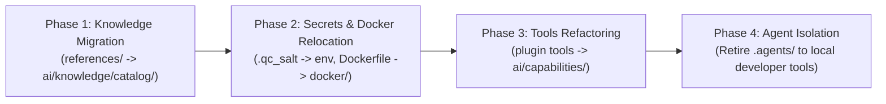

# MOTION — Batch 4: Agentless Architecture Dependency Assessment

> **Author:** Principal Systems Architect & Senior Verification Engineer  
> **Status:** Authoritative Architectural Assessment  
> **Target:** System Owner & Engineering Leadership  
> **Constraint:** No files in `.agents/` or `references/` are deleted in Batch 4.

---

## 1. Executive Summary & Strategic Objective

The owner intends for **MOTION** to operate as an independent, fully autonomous backend product driven by external AI provider APIs (e.g., OpenAI, Anthropic, ElevenLabs, Pexels) and deterministic algorithms, **without requiring a resident coding agent** (such as Claude Code, Gemini CLI, or IDE agents) in production.

This assessment audits every component residing within `.agents/` and `references/` to determine:
1. What is genuinely required by the production runtime?
2. What represents essential creative/engineering knowledge?
3. What is development-agent tooling or legacy scaffolding?
4. How can MOTION be cleanly and safely decoupled from `.agents/` in future batches without breaking existing runtime capabilities or losing valuable domain knowledge?

---

## 2. Dependency Classification Taxonomy

Every item in `.agents/` and `references/` is categorized into one of six strict architectural classes:

| Class | Definition | Production Behavior |
| :--- | :--- | :--- |
| **`PRODUCTION_REQUIRED`** | Code, configuration, or cryptographic data required by live production HTTP requests, workers, or rendering. | Must be retained; slated for migration to standard production paths (e.g., `config/`, `secrets/`). |
| **`REQUIRED_KNOWLEDGE`** | Authoritative markdown playbooks, SOPs, and taste matrices parsed by the AI creative platform. | Ingested by `KnowledgeLoader`; slated for migration to `ai/knowledge/catalog/`. |
| **`BUILD_CI_TOOLING`** | Dockerfiles, container configurations, and CI test scripts. | Retained for DevOps and deployment automation. |
| **`DEV_AGENT_TOOLING`** | Guardrails, hooks, and guidelines designed exclusively for interactive AI coding agents pair-programming with humans. | Not used in production server execution; safe to retire once standalone CLI/SDK is established. |
| **`LEGACY_COMPATIBILITY`** | Historical scripts and MCP server tools superseded by S27/S28 canonical gateways. | Kept as fallback compatibility wrappers; safe to deprecate. |
| **`UNUSED_OR_SCRATCH`** | Temporary logs, session scratchpads, or redundant virtual environments. | Safe to purge in maintenance cycles. |

---

## 3. Comprehensive Inventory & Component Classification

### 3.1 Directory: `references/` (25 Files)

| File / Subtree | Classification | Architectural Role | Future Migration Target |
| :--- | :--- | :--- | :--- |
| `references/1_playbooks/ffmpeg_recipes.md` | `REQUIRED_KNOWLEDGE` | Authoritative FFmpeg commands and audio mixing parameters. | `ai/knowledge/catalog/playbooks/` |
| `references/1_playbooks/living_canvas.md` | `REQUIRED_KNOWLEDGE` | Narrative structure and visual hierarchy for Living Canvas videos. | `ai/knowledge/catalog/playbooks/` |
| `references/1_playbooks/motion_collage.md` | `REQUIRED_KNOWLEDGE` | Living collage cutout animation playbook. | `ai/knowledge/catalog/playbooks/` |
| `references/1_playbooks/review_video.md` | `REQUIRED_KNOWLEDGE` | Competitor conquest review video playbook. | `ai/knowledge/catalog/playbooks/` |
| `references/1_playbooks/tabletop_explainer.md` | `REQUIRED_KNOWLEDGE` | Multi-tier tabletop explainer video playbook. | `ai/knowledge/catalog/playbooks/` |
| `references/1_playbooks/video_copy.md` | `REQUIRED_KNOWLEDGE` | Spoken cadence, word budget, and pacing rules. | `ai/knowledge/catalog/playbooks/` |
| `references/2_sops/hyperrealistic_image.md` | `REQUIRED_KNOWLEDGE` | Prompt engineering rules for hyperrealistic visuals. | `ai/knowledge/catalog/sops/` |
| `references/2_sops/plan_template.md` | `REQUIRED_KNOWLEDGE` | Structural markdown template for human-agent video plans. | `ai/knowledge/catalog/sops/` |
| `references/2_sops/seedance_avatar.md` | `REQUIRED_KNOWLEDGE` | Avatar generation, green-screen extraction SOP. | `ai/knowledge/catalog/sops/` |
| `references/2_sops/spoken_vo_humanizer.md` | `REQUIRED_KNOWLEDGE` | Phonetic humanization guidelines for TTS engines. | `ai/knowledge/catalog/sops/` |
| `references/2_sops/template_proposal.md` | `REQUIRED_KNOWLEDGE` | Guidelines for proposing and validating new templates. | `ai/knowledge/catalog/sops/` |
| `references/3_engineering/remotion_guide.md`| `REQUIRED_KNOWLEDGE` | Remotion lifecycle, spring physics, and performance rules. | `documentation/guides/remotion/` |
| `references/4_taste_engine/*.md` (10 files) | `REQUIRED_KNOWLEDGE` | The Taste Engine: SFX binding matrix, typography pairings, color harmonies, and motion personalities. | `ai/knowledge/catalog/taste/` |
| `references/ROUTER.md` | `LEGACY_COMPATIBILITY` | Legacy monolithic recipe router; superseded by `ai/recipes/matcher.py`. | Archive / Deprecate |
| `references/README.md` | `ARCHIVAL_DOC` | Documentation index. | Archive |

### 3.2 Directory: `.agents/` (161+ Tracked Files)

| File / Subtree | Classification | Architectural Role | Future Migration Target |
| :--- | :--- | :--- | :--- |
| `.agents/secrets/.qc_salt` | `PRODUCTION_REQUIRED` | Cryptographic HMAC salt used by `ReviewService` to sign QC reports. | `config/secrets/.qc_salt` (or env var `QC_HMAC_SALT`) |
| `.agents/docker/Dockerfile.remotion` | `BUILD_CI_TOOLING` | Production Docker image containing Chromium, Node, Remotion, and FFmpeg for hermetic cloud renders. | `docker/Dockerfile.remotion` |
| `.agents/guardian/` (8 files) | `DEV_AGENT_TOOLING` | Guardian security hooks (`behavior_guard.py`, `command_guard.py`, `write_guard.py`) invoked via `hooks.json` to prevent interactive agent regressions. | Retain in dev root; no server runtime dependency. |
| `.agents/plugins/super-video-maker-plugin/mcp_config.json` | `LEGACY_COMPATIBILITY` | Configuration for local Model Context Protocol (MCP) servers. | Governed by `ai/tools/gateway.py`; retire raw MCP client. |
| `.agents/plugins/super-video-maker-plugin/tools/*.py` | `LEGACY_COMPATIBILITY` | Standalone Python tools (TTS, HeyGen, Fal, Replicate, Video Captioner). Replaced by S27/S28 ToolGateway capabilities. | Move reusable logic to `ai/capabilities/`; deprecate direct tool calls. |
| `.agents/plugins/super-video-maker-plugin/tools/mcp-servers/` | `UNUSED_OR_SCRATCH` | Embedded Python virtual environments (`.venv/`) and packages for local MCP servers. | Safe to un-track and delete; duplicates repo root env. |
| `.agents/plugins/super-video-maker-plugin/verify.py` | `BUILD_CI_TOOLING` | Self-test verification script for legacy plugin capabilities. | `scripts/ci/verify_plugin_compat.py` |
| `.agents/skills/prompt-engineering-expert/` | `DEV_AGENT_TOOLING` | Interactive prompt optimization skill for developer agents. | Keep in developer config; not in server runtime. |
| `.agents/teamwork/` | `UNUSED_OR_SCRATCH` | Scratchpads, dispatch records, and logs from prior agent swarm experiments. | Safe to delete. |
| `.agents/AGENTS.md` | `DEV_AGENT_TOOLING` | Directives and behavioral instructions for interactive coding assistants. | Move to repo root `.github/` or `docs/`. |

---

## 4. Deep Inspection of Key Critical Components

### 4.1 KnowledgeLoader (`ai/knowledge/loader.py`)
- **Current Behavior:** `KnowledgeLoader.get_canonical_descriptors()` defines 18 canonical descriptors that map directly to `references/1_playbooks/`, `references/2_sops/`, and `references/4_taste_engine/`. In strict mode, it reads these files and validates their SHA-256 hashes.
- **Finding:** The *content* of `references/` is pure domain knowledge (copywriting rules, sound design, typography guidelines). The system does NOT depend on an AI coding agent to read them; the backend Python service `KnowledgeLoader` reads and indexes them into memory.
- **Verdict:** Highly valuable domain asset. Moving `references/` to `ai/knowledge/catalog/` eliminates the awkward root directory without altering a single line of business logic.

### 4.2 SkillLoader (`ai/skills/loader.py`)
- **Current Behavior:** `SkillLoader.get_canonical_skills()` hardcodes authoritative `SkillDefinition` objects directly in Python code (e.g., `skill_motion_typography`, `skill_speech_sync`, `skill_taste_enforcement`). It contains an optional helper `load_from_markdown()` that can read `.agents/skills/`.
- **Finding:** In production, MOTION relies exclusively on the hardcoded canonical skills returned by `get_canonical_skills()`. It does NOT require any `.agents/skills/` markdown file to execute runs or compile blueprints.
- **Verdict:** Fully autonomous. The backend is already agentless in its skill execution.

### 4.3 MCP Compatibility Layers & Tool Gateway (`ai/tools/gateway.py`)
- **Current Behavior:** Batch 2 & 3 established the `ToolGateway` and `CapabilityRouter`. External media generation (TTS, music, stock footage) is mediated through Pydantic contracts (`TTSRequest`, `MediaSearchRequest`). Direct MCP tool calls (`video_recipes.py`, `Video_Editor_MCP`) are explicitly quarantined.
- **Finding:** The runtime does not invoke MCP servers. All capabilities route through Python providers or local fallbacks.
- **Verdict:** MCP is purely an optional developer interface, not a production dependency.

### 4.4 Docker Rendering Configuration (`.agents/docker/Dockerfile.remotion`)
- **Current Behavior:** Defines a multi-stage Debian-based container with Node.js 20, Python 3.12, Chromium, and FFmpeg for hermetic cloud renders.
- **Finding:** This Dockerfile is production-critical for cloud deployments (AWS ECS, Google Cloud Run, Kubernetes), but its location under `.agents/docker/` is an artifact of earlier prototypes.
- **Verdict:** Relocate to standard `docker/Dockerfile.remotion`.

### 4.5 Security Salt (`.agents/secrets/.qc_salt`)
- **Current Behavior:** `scripts/gates/probe_qc.py` and `api/services/review_service.py` fall back to reading `.agents/secrets/.qc_salt` if the `QC_HMAC_SALT` environment variable is unset.
- **Finding:** Secrets must never reside in an `.agents/` folder or be tracked in source control.
- **Verdict:** Support standard environment variable injection (`QC_HMAC_SALT`) with secure fallback to a local machine secret in `data/secrets/.qc_salt`.

---

## 5. Safe Future Decommissioning Roadmap (Post-Batch 4)

To achieve a clean, pristine repository structure that completely separates active backend product code from developer agent tooling, execute the following 4-phase migration plan in a future batch:

### Phase 1: Migrate Knowledge Catalog
1. Move `references/` markdown files to `ai/knowledge/catalog/`.
2. Update URI paths in `ai/knowledge/loader.py` canonical descriptors.
3. Verify with `pytest tests/ai/unit/test_s28_02_skills_knowledge.py`.
4. Delete `references/` from repository root.

### Phase 2: Relocate Secrets & Container Configurations
1. Move `.agents/docker/Dockerfile.remotion` to `docker/Dockerfile.remotion`.
2. Update CI workflows and build scripts to reference `docker/`.
3. Configure `ReviewService` and `probe_qc.py` to prioritize `os.environ["QC_HMAC_SALT"]`.
4. Remove `.agents/secrets/` from git tracking.

### Phase 3: Transition Plugin Tools to Domain Capabilities
1. Extract any remaining active media helpers from `.agents/plugins/super-video-maker-plugin/tools/` into `ai/capabilities/` or `scripts/core/media/`.
2. Delete the embedded virtual environments (`.venv/`) inside the plugin folder.

### Phase 4: Final Agent Directory Cleanup
1. Move `.agents/AGENTS.md` and rules to standard `.github/` contributor guides.
2. The core repository becomes 100% agentless and standard for any backend engineer or CI/CD system.

---

## 6. Strategic Conclusion

> **Key Architectural Takeaway:**  
> **MOTION's production runtime does NOT depend on a resident coding agent.**  
> The backend operates as a fully autonomous Python/TypeScript appliance driven by deterministic algorithms and external API integrations. The files currently in `.agents/` and `references/` are either **authoritative domain knowledge** (which should simply live in `ai/knowledge/`), **DevOps build configs** (which belong in `docker/`), or **developer assistant hooks** (which are non-operational in production).  
> 
> The system is ready to operate independently.
