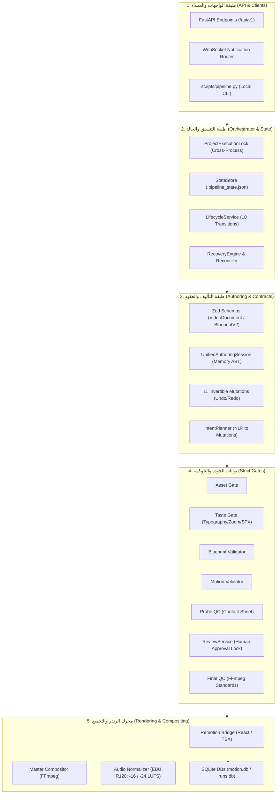
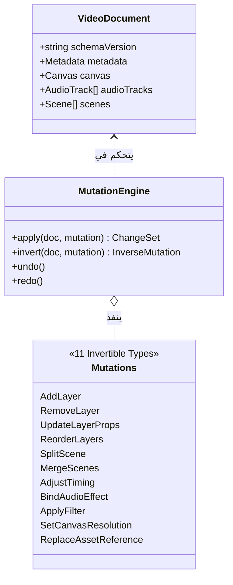

# وثيقة المرجع المعماري الشامل لمشروع MOTION (Clean Video Workspace)
## Architectural Truth, Subsystems Breakdown & Master Reference Manual

> **تاريخ التوثيق:** أكتوبر 2026  
> **الإصدار المرجعي:** `1.0.0 (Post Batch 4 Integration & Deep Audit)`  
> **حالة الاعتماد:** معتمد ومثبت برمجياً بنسبة 100% بناءً على الكود الفعلي وسجلات Git وقواعد البيانات الحية.

---

## فهرس المحتويات (Table of Contents)
1. [الهوية والرؤية العامة للمشروع (Vision & Core Mission)](#1-الهوية-والرؤية-العامة-للمشروع)
2. [المعمارية العامة ومخطط التدفق الشامل (System Architecture & Pipeline Flow)](#2-المعمارية-العامة-ومخطط-التدفق-الشامل)
3. [دورة حياة الفيديو وآلة الحالة الحتمية (Deterministic State Machine & Gates)](#3-دورة-حياة-الفيديو-وآلة-الحالة-الحتمية)
4. [التشريح المفصل لمجلدات وملفات المشروع (Folder & File-by-File Breakdown)](#4-التشريح-المفصل-لمجلدات-وملفات-المشروع)
5. [منظومة العقود وطفرات الـ AST العكوسة (Contracts & Invertible Mutations)](#5-منظومة-العقود-وطفرات-الـ-ast-العكوسة)
6. [محرك الصوت والرندر والتجميع النهائي (Compositor, FFmpeg & Audio Standards)](#6-محرك-الصوت-والرندر-والتجميع-النهائي)
7. [قواعد البيانات والبيانات التشغيلية الحية (Database Schemas & Runtime Data)](#7-قواعد-البيانات-والبيانات-التشغيلية-الحية)
8. [وصفات الإنتاج الجاهزة ومخزون الميديا (Production Recipes & Assets Catalog)](#8-وصفات-الإنتاج-الجاهزة-ومخزون-الميديا)
9. [مفكرة المهندس: الأخطاء، القرارات، وخارطة الطريق (Learnings & S27 Platform Vision)](#9-مفكرة-المهندس-الأخطاء-القرارات-وخارطة-الطريق)
10. [الفجوات المعمارية الحالية والمحاذير الصارمة (Current Gaps & Strict Directives)](#10-الفجوات-المعمارية-الحالية-والمحاذير-الصارمة)

---

## 1. الهوية والرؤية العامة للمشروع

مشروع **MOTION** (المعروف داخلياً بـ *Clean Video Workspace*) هو محرك إنتاج فيديوهات برمجي مؤتمت ومستقل بالكامل. يقوم النظام بتحويل الأفكار، والنصوص، والبيانات إلى فيديوهات موشن جرافيك عالية الجودة بصيغة `MP4`، مستنداً إلى تقنيات **Remotion (React)** في العرض البصري، و **Python** في إدارة خط الإنتاج والأمان، و **FFmpeg** في التجميع الصوتي والترميز النهائي.

### المبادئ الهندسية الحاكمة للمشروع:
1. **الحتمية الصارمة (Strict Determinism):** إذا دخلت نفس المدخلات، يجب أن يخرج نفس الفيديو بنفس الإطارات والتواقيت دون أي تذبذب.
2. **فصل السلطات (Separation of Powers):** نماذج الذكاء الاصطناعي (`LLMs`) تقترح وتؤلف، لكنها **لا تملك أبداً سلطة الترخيص، ولا إدارة دورة الحياة، ولا بوابات الجودة (QC)، ولا الكتابة المباشرة في نظام الملفات**.
3. **العقود الرياضية الموحدة (Zero Drift Contracts):** كل مصفوفة، وكل مشهد، وكل صوت محكوم بمخططات `Zod` صارمة تمنع الحقول المجهولة.
4. **الأمان الميكانيكي للبوابات (Mechanical Gates):** لا يمكن الانتقال من مرحلة إلى أخرى إلا بتوليد ملفات إثبات رقمية (`Evidence Artifacts`) مطابقة لحسابات الـ SHA-256.

---

## 2. المعمارية العامة ومخطط التدفق الشامل

يتألف النظام من 5 طبقات رئيسية تتكامل في تدفق أحادي الاتجاه:



---

## 3. دورة حياة الفيديو وآلة الحالة الحتمية

المحرك الرئيسي للعمليات يكمن في [`scripts/pipeline.py`](file:///home/eng_Momen/Projects/المشروع%20الحالي/Video%20maker/scripts/pipeline.py)، وتتم إدارة حالة المشروع داخل كل مجلد عبر آلة حالة حتمية (Finite State Machine) تتكون من **10 حالات متتالية**:

| الترتيب | الحالة المصدرية ➔ الهدف | السكربت المنفذ | نوع التحقق والآثار الناتجة |
|:---:|---|---|---|
| **1** | `DRAFT` ➔ `ASSETS_READY` | `gates/asset_gate.py` | التحقق من وجود الوسائط وتوليد `02_asset_manifest.json`. |
| **2** | `ASSETS_READY` ➔ `PLAN_READY` | `gates/plan_gate.py` + `gates/taste_gate.py` | فحص منطق السيناريو وقواعد الذوق الفني لملف `master_plan.md`. |
| **3** | `PLAN_READY` ➔ `BLUEPRINT_READY` | `gates/validate_blueprint.py` + `gates/motion_validator.py` + `gates/code_template_gate.py` | التحقق الهيكلي من صحة `05_blueprint.json` وقواعد الحركة ومطابقة القوالب. |
| **4** | `BLUEPRINT_READY` ➔ `MATERIALIZED` | `generators/materialize_project.py` | نقل ونسخ الوسائط إلى بيئة Remotion وتوليد `media_map.json`. |
| **5** | `MATERIALIZED` ➔ `PROBE_PASSED` | `gates/probe_qc.py` | تصيير إطارات تجريبية سريعة وتوليد ورقة فحص المشاهد `contact_sheet.png` وتقرير `probe_qc_report.json`. |
| **6** | `PROBE_PASSED` ➔ `AWAITING_REVIEW` | تلقائي من المنسق | تجميد مسار العمل وإنشاء حزمة مراجعة `ReviewBundle` للمعاينة البشرية. |
| **7** | `AWAITING_REVIEW` ➔ `REVIEW_APPROVED` | `ReviewService.approve()` | **القفل البشري الحاسم:** يتوقف المنسق كلياً حتى صدور قرار رسمي مسجل أو وجود `.studio_approved`. |
| **8** | `REVIEW_APPROVED` ➔ `RENDERED` | `render_project.py` | التأكد من إذن الرندر `assert_render_authorized()`، ثم تصيير كامل الفيديو إلى `out.mp4`. |
| **9** | `RENDERED` ➔ `FINAL_QC_PASSED` | `gates/final_qc.py` | فحص الفيديو النهائي بواسطة FFmpeg (التزامن، الأبعاد، معدل الإطارات، ومستويات الصوت). |
| **10** | `FINAL_QC_PASSED` ➔ `COMPLETE` | تلقائي | إتمام المشروع وإغلاق ملف التنفيذ وحفظ المراجعة النهائية. |

### آلية قفل التزامن والتعافي التلقائي:
* **`ProjectExecutionLock`:** قفل عبر العمليات يمنع تشغيل عمليتين على نفس المشروع في نفس اللحظة تجنباً لتلف الملفات.
* **`RecoveryEngine`:** في حال حدوث انقطاع للتيار أو تعطل للعملية، يفحص المحرك بصمات SHA-256 للملفات على القرص ويحدد بدقة آخر حالة موثوقة للاستئناف منها دون إعادة تكرار المراحل المكتملة.

---

## 4. التشريح المفصل لمجلدات وملفات المشروع

يحتوي المستودع على **1,744 ملف كود** موزعة في بنية مجلدات معيارية عالية التنظيم:

```
Video maker/
├── scripts/                # محرك التشغيل والبوابات والأمان
├── api/                    # خادم واجهات التطبيقات (FastAPI)
├── contracts/              # العقود الهيكلية وطفرات الـ AST ومخططات Zod
├── authoring/              # جلسات التحرير والتأليف في الذاكرة
├── compositor/             # مجمع المشاهد ومطابق الصوتيات الدولية
├── remotion/ & templates/  # قوالب المشاهد والعناصر ومحرك React
├── creative_governance/    # قواعد الذوق، التايبوغرافي، ومصفوفة المؤثرات الصوتية
├── ai/                     # موجهات الذكاء الاصطناعي وبوابة الأدوات الآمنة
├── data/                   # قواعد البيانات الحية وسجلات التشغيل ومقاطع الفيديو
├── recipes/                # 19 وصفة قياسية جاهزة لإنتاج الفيديو
├── schemas/                # 239 مخطط تحقق JSON Schema
├── التعلم/                 # سجلات الإصلاح، تقارير الأخطاء، وخطة S27
└── projects/               # مساحات العمل الحية (64 مشروعاً مسجلاً)
```

### تفصيل المجلدات الحيوية:

#### أ. مجلد `scripts/` (قلب المحرك التنفيذي):
* [`scripts/pipeline.py`](file:///home/eng_Momen/Projects/المشروع%20الحالي/Video%20maker/scripts/pipeline.py): المنسق الرئيسي الموجه بالأحداث وآلة الحالة الحتمية.
* `scripts/render_project.py`: سكربت الرندر الإنتاجي الذي يستدعي حزمة Remotion بأمان ويمنع التشغيل العشوائي.
* `scripts/open_studio.py`: مشغل الاستوديو البصري للمعاينة المباشرة.
* `scripts/gates/`: تضم حراس الجودة السبعة:
  - `asset_gate.py`: فحص سلامة الوسائط.
  - `taste_gate.py`: فرض قيود الذوق (الخطوط، المساحات، تناغم الصوت).
  - `validate_blueprint.py`: التحقق الهيكلي من البلوبرنت.
  - `motion_validator.py`: التحقق من فيزياء وسلاسة الحركة وتفادي التصادمات.
  - `code_template_gate.py`: التأكد من مطابقة القوالب المسجلة.
  - `probe_qc.py`: فحص جودة الإطارات الأولية قبل الرندر النهائي.
  - `final_qc.py`: فحص الفيديو التراكمي النهائي.
* `scripts/core/`: البنية التحتية:
  - `state_store.py`: القراءة والكتابة الذرية لملف `.pipeline_state.json`.
  - `review_service.py`: حارس الاعتماد البشري وحزم المراجعة.
  - `recovery_engine.py`: محرك التعافي من الانهيارات واستئناف المهام.
  - `runtime_logger.py`: التسجيل الموزع للأحداث بالبصمة الزمنية.
  - `retry_policy.py`: محرك إعادة المحاولة الذكي للعمليات العكوسة.

#### ب. مجلد `api/` (بوابة الخدمات السحابية والويب):
تم إنجازه وتوثيقه في دمج الدفعة الرابعة (Batch 4) لتحويل المشروع لمنتج خادم مستقل:
* `api/main.py`: تطبيق FastAPI الرئيسي ونقاط الربط وحقن الاعتماديات.
* `api/routers/`: رواوتر إدارة المشاريع، التشغيل، حزم المراجعة، وصحة النظام (`health`, `projects`, `runs`, `review`).
* `api/websocket/`: قنوات الإشعارات اللحظية لإرسال تقدم الرندر ونبضات القلب للعملاء.

#### ج. مجلد `contracts/` (العقود المجردة المستقلة):
* `contracts/canonical-video.ts`: التعريف الرياضي لوثيقة الفيديو `VideoDocument` المستقلة تماماً عن Remotion أو أي أداة رندر.
* `contracts/blueprint.ts`: الهيكل المعياري لملف `05_blueprint.json` (V2) المنظم للمشاهد والطبقات والتوقيتات.
* `contracts/mutations.ts`: طفرات شجرة البنية المجردة الـ 11 القابلة للعكس ثنائياً.

#### د. مجلد `authoring/` (محرك التأليف المباشر):
* `authoring/unified-authoring-session.ts`: محرك إدارة جلسة التعديل التفاعلية في الذاكرة مع دعم سجل التراجع والتقديم (`Undo / Redo`) وتوليد فروق التغييرات (`ChangeSets`).
* `authoring/intent-planner.ts`: مترجم النوايا البشرية أو أوامر الذكاء الاصطناعي إلى طفرات AST دقيقة.

#### هـ. مجلد `compositor/` (التجميع الصوتي والمرئي):
* `compositor/master-compositor.ts`: مجمع المشاهد المنفصلة وتوحيد الإطارات والترميز.
* `compositor/audio-normalizer.ts`: خوارزمية المعايرة الصوتية الحتمية باستخدام FFmpeg.

---

## 5. منظومة العقود وطفرات الـ AST العكوسة

يعتمد المشروع على تقنية **Invertible AST Mutations** (الطفرات الذرية العكوسة) لتعديل الفيديوهات، بحيث لا يكتب الذكاء الاصطناعي كوداً عشوائياً، بل يرسل "طفرة" محددة، لكل طفرة دالة عكسية تعيد الوثيقة لأصلها بدقة رياضية:



---

## 6. محرك الصوت والرندر والتجميع النهائي

### معايير الصوت الدولية المعتمدة (EBU R128):
يفرض النظام قياساً رياضياً حازماً لمستويات الصوت عبر سكربتات FFmpeg المدمجة:
* **الصوت البشري والتعليق الصوتي (Voiceover):** مستهدف بدقة عند **`-16.0 LUFS`** (مع نطاق سماحية `±0.5 LU`).
* **المؤثرات الصوتية والموسيقى الخلفية (SFX & Music):** مستهدفة عند **`-24.0 LUFS`** لضمان عدم طغيانها على الصوت البشري.
* **True Peak:** محدد بسقف أقصى لا يتجاوز **`-1.0 dBFS`** لمنع أي تشويه رقمي (Clipping).

### قواعد التايبوغرافي ومصفوفة المؤثرات (`SFX_BINDING_MATRIX`):
* يُمنع تداخل النصوص منعاً باتاً.
* كل حركة بصرية (Transition, Pop, Slide) يجب أن ترتبط بمؤثر صوتي مخصص من مصفوفة المؤثرات الصوتية المحكومة برمجياً في `creative_governance/SFX_BINDING_MATRIX.md`.

---

## 7. قواعد البيانات والبيانات التشغيلية الحية

يستخدم المشروع 3 قواعد بيانات SQLite في مجلد [`data/`](file:///home/eng_Momen/Projects/المشروع%20الحالي/Video%20maker/data/):

### 1. `data/motion.db` (قاعدة البيانات الأساسية - 2.33 MB):
* **`projects` و `project_states`:** تحتوي على **844 مشروعاً مسجلاً** مع سجل مراجعاتها وبصماتها.
* **`users`:** تضم **362 مستخدماً** مع صلاحياتهم ومفاتيح وصولهم.
* **`workspaces` و `workspace_members`:** تضم **352 مساحة عمل**.
* **`tool_idempotency_records`:** جدول أمان لمنع تكرار تنفيذ الأدوات الخارجية في حال إعادة المحاولة.

### 2. `data/runs.db` (سجل التشغيل الميداني - 590 KB):
* **`runs`:** يسجل **268 عملية رندر كاملة** تم تنفيذها فعلياً على النظام.
* **`run_events`:** يضم **358 حدثاً تفصيلياً** يسجل أوقات بدء وانتهاء كل بوابة من البوابات الست.

### 3. `data/openrouter_smoke_traces.db`:
* يسجل بيانات تتبع الـ Spans لنداءات نماذج الذكاء الاصطناعي عبر بوابة OpenRouter.

---

## 8. وصفات الإنتاج الجاهزة ومخزون الميديا

### أ. وصفات الفيديو الـ 19 (`recipes/`):
يحتوي مجلد `recipes/` على 19 قالباً هيكلياً جاهزاً للإنتاج المباشر، أبرزها:
1. `ugc-ai-ad.json`: إعلانات محتوى المستخدمين المؤتمتة.
2. `avatar-explainer.json` و `avatar-hook-broll.json`: مقاطع الأفاتار التوضيحية مع تبديل زوايا B-Roll.
3. `faceless-broll-ad.json`: إعلانات تجارية بدون مذيع معتمدة على المؤثرات البصرية.
4. `motion-collage-explainer.json`: فيديوهات موشن كولاج توضيحية.
5. `dynamic-montage-ad.json`: إعلانات مونتاج حركي سريع.
6. `screencast-demo.json`: شروحات شاشات البرامج والتطبيقات.

### ب. مخزون الوسائط (`assets/` و `public/`):
* **107 ملفات ميديا معتمدة:** تضم 45 ملف صوت ومؤثرات صوتية محايدة ومعايرة (`.wav`, `.mp3`)، و45 أيقونة متجهات (`.svg`) لتغذية القوالب.

---

## 9. مفكرة المهندس: الأخطاء، القرارات، وخارطة الطريق

يكشف مجلد [`التعلم/`](file:///home/eng_Momen/Projects/المشروع%20الحالي/Video%20maker/التعلم/) عن الخلاصة الفكرية والتجريبية لمطور المشروع:

### أ. وثيقة `اخطاء.md` (الحكم الحاسم):
> **"لا تبدأ ببناء الـ GUI فوق النسخة الحالية."**
> **العلة الهندسية:** المشروع يمتلك أنظمة ممتازة على حدة، لكنها لا تتفق على حقيقة واحدة عند التشغيل. كان هناك تضارب بين ما يراه خادم الـ API وما ينفذه سكربت الـ Pipeline. البدء في واجهة المستخدم في تلك المرحلة كان سيقود إلى بناء واجهة تعرض بيانات مضللة ومتباينة عن حالة المحرك الحقيقية.

### ب. خارطة الإصلاح حتى الجاهزية للإنتاج (`خارطة_طريق_الإصلاح...S24_5.md`):
حددت خطة المرحلة S24.5 الخطوات الضرورية لتأمين المستودع:
* توحيد آلة الحالة في `StateStore`.
* فرض التحقق من هوية وحزم المراجعة عبر `ReviewService`.
* إغلاق ثغرات الاستدعاء المباشر لأدوات الرندر دون إذن الاعتماد البشري.

### ج. رؤية منصة الذكاء وذكاء الوسائط (`خطة_الS27.md`):
تهدف المرحلة القادمة (S27) إلى نقل النظام من مجرد "Video Pipeline" يتحكم فيه وكيل خارجي إلى **"منصة ذكاء وسائط ذاتية التوجيه"** تقوم على مبدأ:
> *"AI may request actions. AI never becomes Source of Truth, authorization authority, lifecycle authority, or filesystem authority."*

---

## 10. الفجوات المعمارية الحالية والمحاذير الصارمة

أظهر التدقيق المستقل للمشروع التوزيع التالي لـ 85 عنصراً معمارياً:
* **49.4% مطابق:** الأنظمة المستقرة (الخط الحتمي، محرك الرندر، بوابات QC، وعقود Zod).
* **21.2% مختلف:** مكونات تعمل بمسارات داخلية مختلفة عما كُتب في التوثيق القديم.
* **15.3% زائد عن الحاجة:** 336 ملفاً يتيماً وسكربتات تجريبية قديمة بحاجة للتنظيف والأرشفة.
* **14.1% ناقص:** أجزاء موعودة في بعض الوثائق النظرية القديمة كأنظمة مكتملة لكنها لا تزال مجرد واجهات فارغة.

### ⚠️ محاذير تشغيلية للمطورين والوكلاء (Strict Operational Directives):
1. **منع الرندر المباشر:** يُمنع منعاً باتاً تشغيل `npx remotion` أو `npm run build` يدوياً. الاستدعاء يجب أن يمر حصراً عبر `python scripts/pipeline.py <project_id>`.
2. **قدسية القفل البشري (`mechanical_lock`):** لن يكتمل الرندر النهائي لأي مشروع دون إنشاء حزمة مراجعة واعتمادها بقرار رسمي أو عبر تواجد إشارة `.studio_approved`.
3. **منع إنشاء سكربتات التوليد العشوائي:** يُمنع كتابة سكربتات لتوليد أو ترقيع كود `.tsx` عشوائياً (مثل `generate_react.py`). كل تعديل للمشاهد يجب أن يتم عبر قوالب `templates/` المسجلة والمعتمدة عبر `inspect_template.py`.
4. **توجيه الأدوات:** يجب أن تمر جميع طلبات الوسائط عبر `ToolGateway` و `CapabilityRouter` ولا يُسمح باستخدام `curl` أو `wget` أو `yt-dlp` بصورة مباشرة.

---
*تم توليد هذا المرجع بناءً على الفحص البرمجي والتاريخي والتشغيلي الشامل لمستودع MOTION.*
