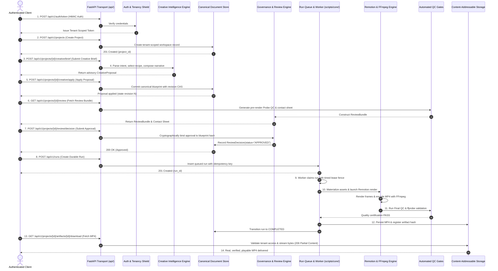

# MOTION Architecture Atlas — System Overview

> **Target Audience:** System Owner, Executive Leadership, Backend Engineers, and System Architects.
> **Scope:** The complete production architecture, runtime lifecycle, and operational philosophy of the MOTION autonomous video generation platform.

---

## 1. What is MOTION?

**MOTION** is an enterprise-grade, multi-tenant autonomous video generation engine. It enables software systems and human creators to submit natural-language creative ideas and receive broadcast-ready, technically verified MP4 video files in return.

Unlike simple video tools or unconstrained AI wrappers that attempt to assemble media through unpredictable script generation, MOTION is engineered as a **deterministic, verifiable video operating system**. 

### The Core Problem MOTION Solves
Creating programmatic video traditionally requires either:
1. **Manual Video Editing:** Slow, expensive, human-intensive, and impossible to scale programmatically.
2. **Generative AI Video Wrappers:** Uncontrolled AI models that hallucinate text, violate brand fonts, misalign audio by milliseconds, or produce corrupt media files with no technical guarantees.
3. **Fragile Ad-Hoc Scripts:** Custom Python or Bash scripts that stitch FFmpeg commands together, which break when aspect ratios change, leak database connections, and lack multi-tenant isolation.

**MOTION eliminates these failure modes** by separating *Creative Intelligence* from *Execution Authority*. AI models are used strictly as **advisory creative architects** (drafting scripts, timing scenes, picking color palettes, selecting sound effects), while a **hardened, hermetic software pipeline** executes the actual rendering, validates typography, enforces audio loudness standards (-16 LUFS for speech, -24 LUFS for sound effects), and cryptographically seals every video before delivery.

```
+---------------------------------------------------------------------------------------------------+
|                                              MOTION                                               |
|                                                                                                   |
|   +-----------------------+      +---------------------------+      +-------------------------+   |
|   |    Creative Request   | ---> |  Advisory AI Intelligence | ---> |  Draft Proposal & Plan  |   |
|   |  (HTTP API / Tenant)  |      |  (Deterministic Recipes)  |      |   (Blueprint Schema)    |   |
|   +-----------------------+      +---------------------------+      +-------------------------+   |
|                                                                                  |                |
|                                                                                  v                |
|   +-----------------------+      +---------------------------+      +-------------------------+   |
|   |  Certified MP4 Video  | <--- |   Probe QC & Final QC     | <--- | Human / Policy Approval |   |
|   |  (HTTP Byte-Stream)   |      |  (Automated Verification) |      | (Cryptographic Binding) |   |
|   +-----------------------+      +---------------------------+      +-------------------------+   |
+---------------------------------------------------------------------------------------------------+
```

---

## 2. Core Architectural Principles

MOTION is built upon seven non-negotiable architectural foundations:

### Principle 1: Knowledge and AI are Advisory, Not Executive Authority
AI models (whether local heuristic planners or external LLMs like OpenAI/Anthropic) produce *creative intent*. They are never given direct shell access, write permissions to production code, or authority to bypass quality checks. AI outputs are parsed into strict Pydantic data schemas (`CreativeProposal`, `ScenePlan`, `BlueprintSpec`) that are validated against rigorous boundary contracts before anything is executed.

### Principle 2: The Sacred Governance Gate (No Render Without Approval)
A render worker will **refuse to render** any project that has not passed formal, cryptographically authenticated review. 
- When an AI proposal is applied, MOTION builds a deterministic `ReviewBundle`.
- The bundle includes automated Contact Sheet images (Probe QC) and technical specifications.
- A human or an authorized automated policy must submit an explicit `ReviewDecision(status="APPROVED")` signed with HMAC credentials.
- The render worker verifies this cryptographic signature against the canonical document hash. If any byte of the blueprint has changed since approval, rendering is instantly blocked (`RENDER_NOT_AUTHORIZED`).

### Principle 3: Strict Multi-Tenancy & Workspace Scoping
Every project, run, asset, document, and artifact belongs strictly to an authenticated `tenant_id` and `workspace_id`.
- Tenant credentials use HMAC-SHA256 authenticated API keys.
- SQL queries enforce workspace and tenant filters at the database engine level.
- Storage directories on disk and object storage are segregated by tenant and project hash.
- Cross-tenant access attempts return strict `403 Forbidden` or `404 Not Found` rejections with zero information leakage.

### Principle 4: Hermetic, Predictable Rendering via React & Remotion
Video rendering is performed by **Remotion**, an industrial React-based programmatic video framework. 
- Instead of brittle FFmpeg command strings, visual scenes are defined as deterministic React components with spring physics, sub-pixel typography rendering, and frame-accurate canvas drawing.
- A standardized `EngineBridge` synchronizes animation timing with exact audio millisecond marks.
- The rendering process runs in a sandboxed, environment-sanitized headless browser engine, guaranteeing identical output across Linux, macOS, and containerized Docker environments.

### Principle 5: Durable Execution & Lease Fencing
Rendering video is a heavy, multi-second computational task. MOTION guarantees system stability through **distributed lease fencing**:
- Project execution is guarded by the `ProjectExecutionLock` backed by durable SQL state (`RunRepository`).
- A worker must acquire an exclusive timed lease on a project before rendering.
- If a worker crashes or loses network connectivity, its heartbeat expires, the lease is reclaimed, and other workers safely recover without duplicate renders or corrupt output files.

### Principle 6: Automated Double-Gate Quality Control (Probe QC + Final QC)
MOTION never delivers an uninspected video file:
- **Pre-Render Probe QC:** Inspects audio tracks, fonts, aspect ratios, and visual contact sheets *before* committing CPU/GPU time to full rendering.
- **Post-Render Final QC:** Executes `ffprobe` and FFmpeg analysis on the generated MP4. Verifies frame rates, container headers, moov atom placement (`faststart` for web streaming), exact duration tolerances, audio synchronization, and loudness bounds.

### Principle 7: Content-Addressable Storage & Range Streaming
Finished videos and uploaded assets are stored using their SHA-256 content hashes.
- When a client requests an MP4 video, the `artifacts` router validates tenant permissions and streams the media using standard HTTP Range headers (`206 Partial Content`).
- This allows web browsers and mobile players to scrub forward and backward through high-definition video smoothly without downloading the entire file first.

---

## 3. The Complete 14-Step Backend Journey

To understand how MOTION works in practice, let us trace a complete request from its initial HTTP connection to the final playable MP4 video.



### Detailed Breakdown of the 14 Stages:

1. **Authentication:** The client sends an HMAC-signed request to authenticate. MOTION verifies the signature, enforces workspace scoping, and assigns a context containing `tenant_id` and `workspace_id`.
2. **Project Creation:** An isolated project record is initialized in the relational database. A dedicated project directory is provisioned on disk with canonical state files.
3. **Creative Request Ingestion:** The client posts a natural-language description (e.g., *"Create a 15-second dynamic product showcase for a modern running shoe with bold typography and electronic music"*).
4. **Advisory AI Generation:** The Creative Intelligence engine matches the prompt against 18 deterministic production recipes, applies typography and color rules, calculates exact scene durations, and builds an advisory `CreativeProposal`.
5. **Proposal Application & Revision CAS:** The client chooses to accept the proposal. MOTION writes the canonical blueprint to the `CanonicalDocumentRepository` using Compare-And-Swap (CAS) revision semantics to prevent accidental overwrites.
6. **Probe QC & Contact Sheet Generation:** The pipeline runs `probe_qc.py`, verifying audio tracks and generating a high-resolution visual contact sheet showing preview thumbnails for every scene.
7. **Human / Policy Governance Decision:** The client (or automated approval agent) reviews the contact sheet and submits an explicit `ReviewDecision(status="APPROVED")`. This approval is cryptographically sealed to the blueprint's SHA-256 hash.
8. **Durable Run Enqueue:** The client requests a production render. An immutable `Run` record is inserted into the queue with a unique idempotency key.
9. **Worker Claim & Lease Fencing:** A background render worker claims the run by acquiring an exclusive lease on the project, preventing any other worker from modifying the project simultaneously.
10. **Hermetic Remotion Rendering:** The worker executes `render_project.py` with sanitized system environment variables. The Remotion React engine renders visual layers frame by frame, blending audio stems and video layers.
11. **Final QC & ffprobe Inspection:** The output video is inspected by `final_qc.py`. `ffprobe` checks that video codec is `h264`, audio codec is `aac`, resolution is 1920x1080 (or requested aspect ratio), frame rate is strictly 30fps, and loudness conforms to broadcast specs.
12. **Storage Persistence & Manifest Sealing:** The certified MP4 is stored in the content-addressable storage pool. A cryptographic provenance record is logged in the run repository.
13. **Authenticated Media Request:** The client requests the video download via the HTTP API, supplying their tenant credentials.
14. **Streaming Delivery:** MOTION validates the client's tenant ownership of the artifact and streams the verified MP4 using HTTP 206 partial range streaming. The client receives a genuine, non-empty, playable video file.

---

## 4. Architectural Summary

| Subsystem | Primary Technologies | Key Files | Core Guarantees |
| :--- | :--- | :--- | :--- |
| **HTTP Transport** | FastAPI, Uvicorn, ASGI | `api/main.py`, `api/routers/*` | Strict schema validation, asynchronous handling, standardized HTTP error responses |
| **Auth & Security** | HMAC-SHA256, Pydantic | `api/auth/*`, `scripts/core/security/*` | Tenant isolation, workspace bounding, path traversal defense, command sanitization |
| **Creative Brain** | Heuristic Planners, LLM Gateway | `ai/creative/*`, `ai/narrative/*`, `recipes/*` | Deterministic recipe matching, word-accurate timing, taste matrix compliance |
| **Governance Gate** | HMAC Signatures, CAS | `api/services/review_service.py` | Strict zero-render-without-approval policy, immutable cryptographic audit seals |
| **Durable Execution** | SQLite / Postgres, File Locks | `scripts/core/worker.py`, `scripts/core/run_repository.py` | Idempotent replay, crash recovery, exclusive project leases, zero duplicate renders |
| **Rendering Engine** | Remotion, React, FFmpeg | `scripts/render_project.py`, `remotion-app/*` | Frame-accurate synchronization, sub-pixel typography, hermetic sandbox execution |
| **Quality Control** | FFprobe, Soundfile, OpenCV | `scripts/gates/*`, `scripts/validators/*` | Automated pre-render probe QC, audio loudness checks, post-render format verification |
| **Storage & Delivery** | Content-Addressable Storage | `api/services/storage_service.py`, `api/routers/artifacts.py` | SHA-256 deduplication, HTTP 206 range streaming, tenant-isolated media access |

MOTION is not an experimental agent script; it is a **fully integrated, secure, resilient video production appliance**.
