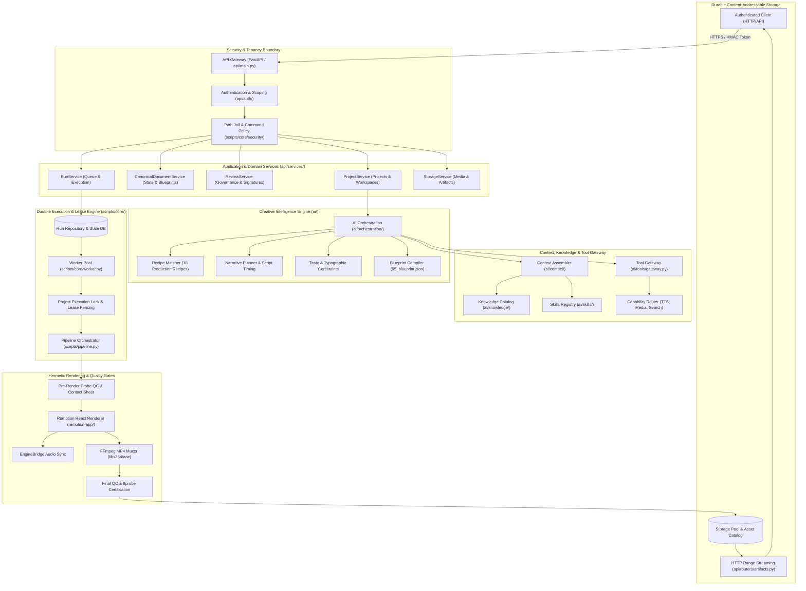
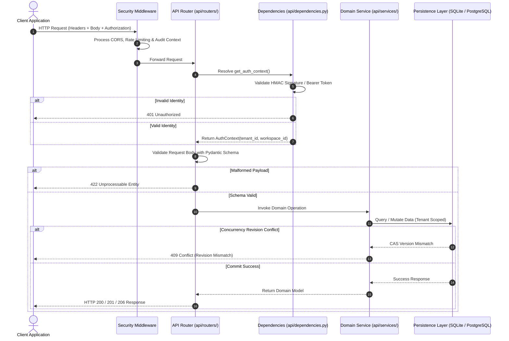
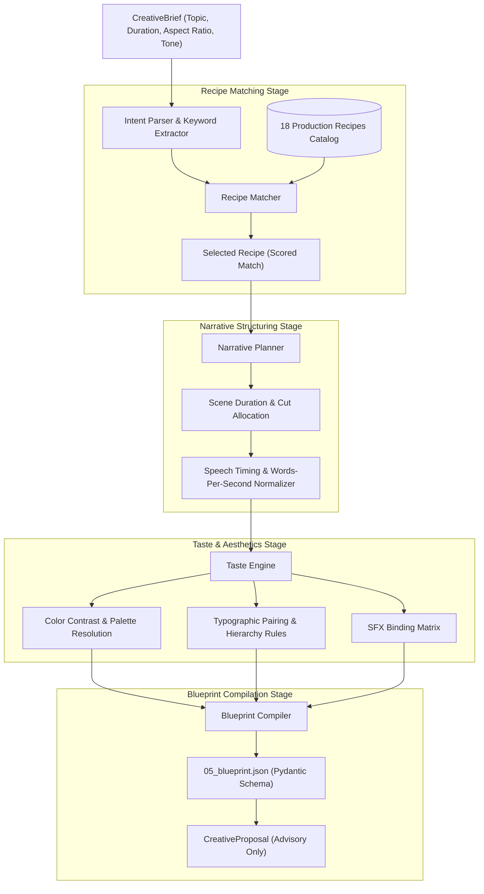
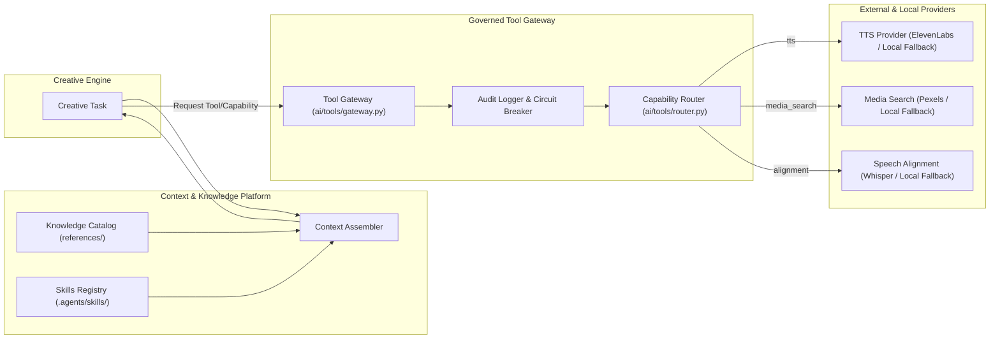
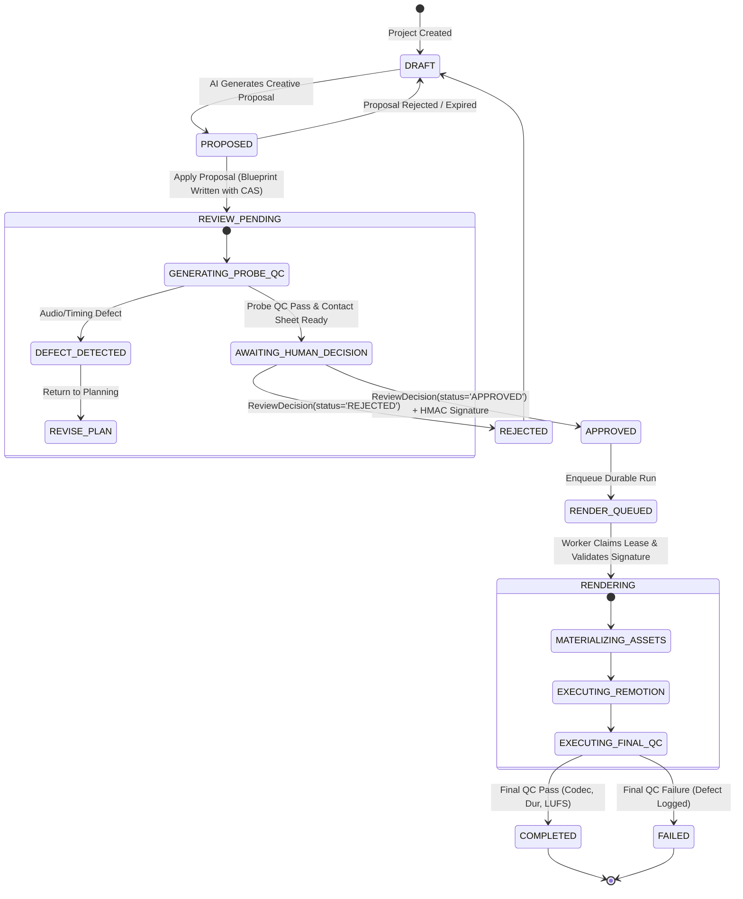
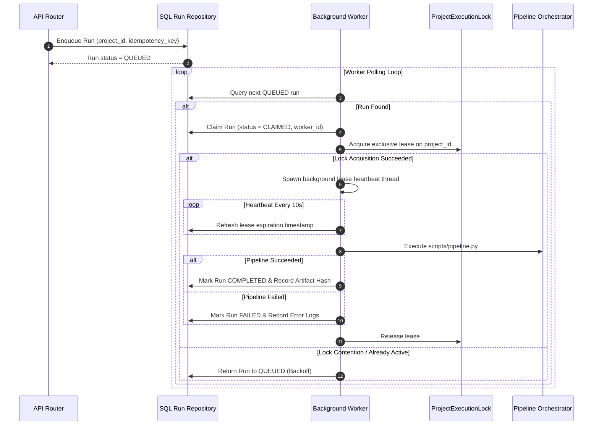
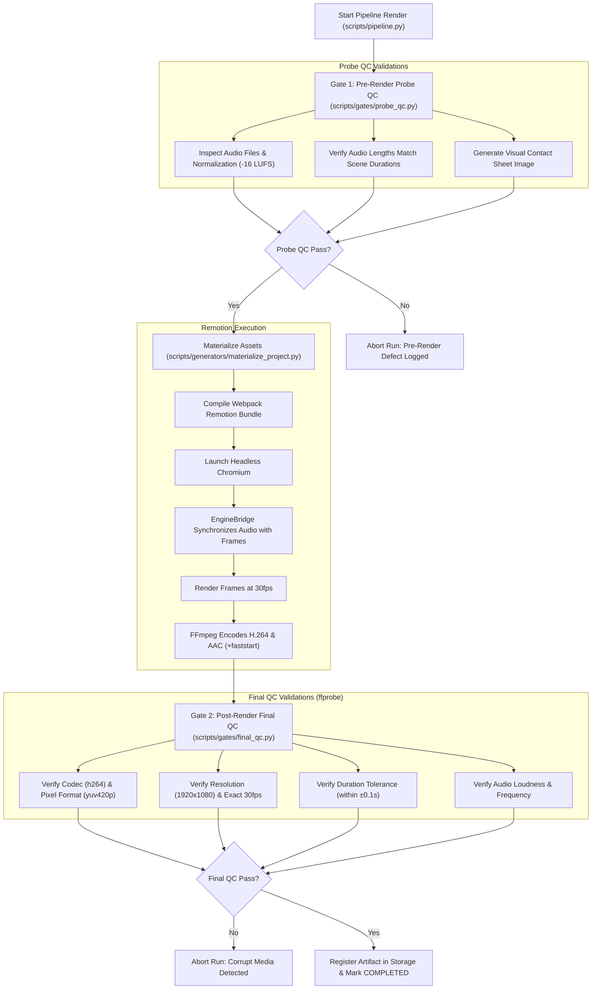
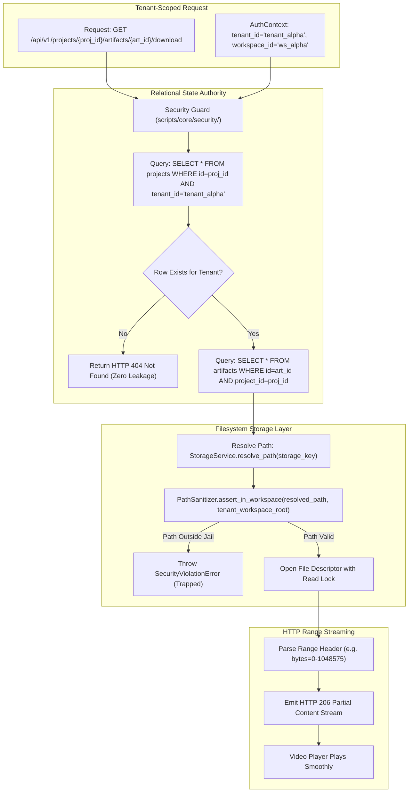

# MOTION Architecture Atlas — Dependency & Execution Graphs

> **Standard:** Authoritative architectural and runtime diagrams constructed strictly from the verified codebase.
> **Diagram Format:** Mermaid syntax adhering to strict renderer compatibility rules (all node labels quoted, standard node naming).

---

## 1. Full System Architecture Map



---

## 2. HTTP Request Lifecycle



---

## 3. AI Planning & Advisory Proposal Generation



---

## 4. Context, Knowledge & Capability Tool Gateway



---

## 5. Review, Governance & Approval State Machine



---

## 6. Durable Worker Execution & Lease Fencing



---

## 7. Rendering & Double-Gate Quality Control



---

## 8. Data Storage & Tenant Isolation



---

## 9. Error Propagation, Retries & Safe Recovery

```mermaid
flowchart TD
    ErrorOccurs["Error Condition Occurs During Execution"] --> ClassifyError{"Classify Error Type"}

    ClassifyError -->|Network Timeout on External AI| AIFallback["Circuit Breaker: Fallback to Local Deterministic Planner"]
    AIFallback --> ContinuePlanning["Continue with Baseline Plan"]

    ClassifyError -->|CAS Revision Conflict| CASConflict["Raise 409 Conflict: Inform Client to Reload State"]
    
    ClassifyError -->|Lock Contention on Project| LeaseConflict["Worker Releases Claim with Exponential Backoff"]
    LeaseConflict --> RetryQueue["Re-queue Run for Next Worker Cycle"]

    ClassifyError -->|Worker Hard Crash (SIGKILL)| HeartbeatDies["Lease Heartbeat Ceases"]
    HeartbeatDies --> LeaseExpires["Timed Lease (60s) Expires in SQL Database"]
    LeaseExpires --> OrphanCollector["Reaper Worker Detects Expired Lease"]
    OrphanCollector --> MarkFailed["Mark Stale Run as FAILED (Reason: WORKER_LOST)"]

    ClassifyError -->|Probe QC Audio Failure| BlockRender["Fail Closed: Mark Review as DEFECT_DETECTED"]
    
    ClassifyError -->|Remotion Compilation Error| CaptureTrace["Capture Subprocess STDERR & Traceback"]
    CaptureTrace --> MarkRunFailed["Mark Run FAILED & Surface Diagnostic to Tenant"]

    ClassifyError -->|Final QC Media Defect| QuarantineMedia["Quarantine Corrupt Video & Mark Run FAILED"]
```
